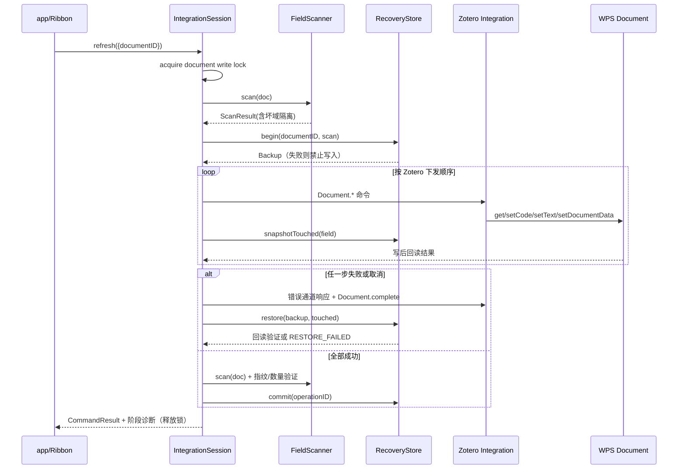
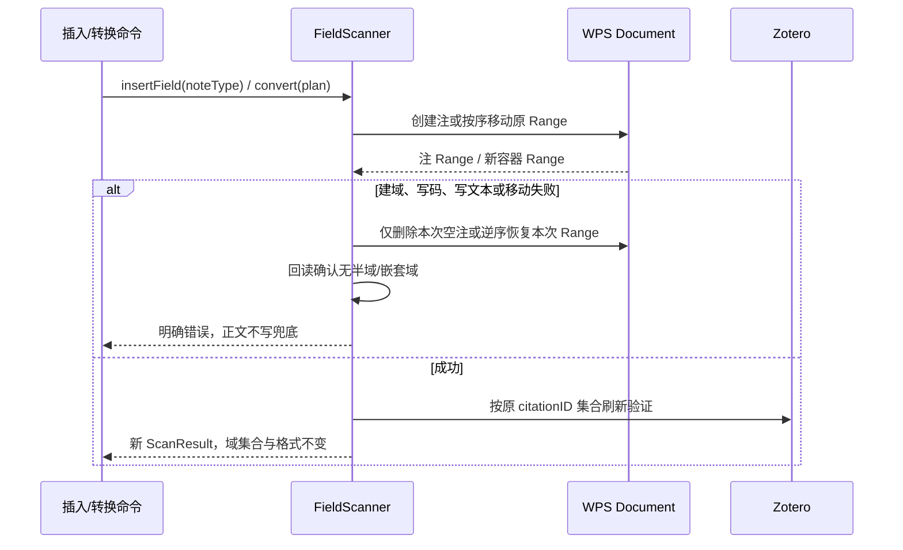
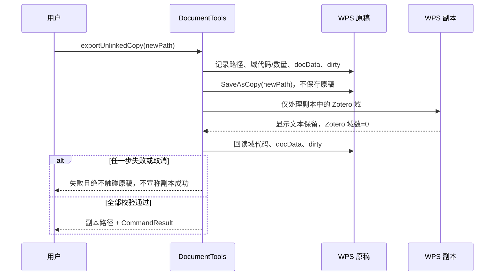
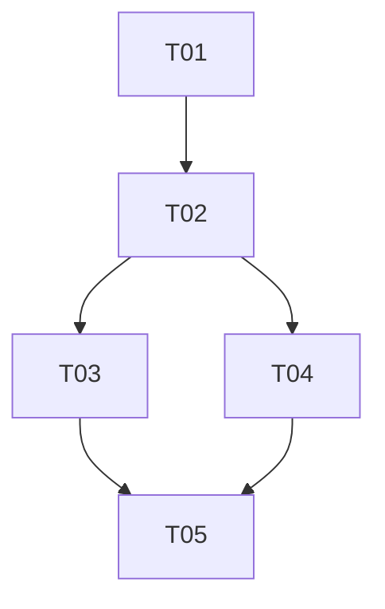

# Papilot Cite for WPS：P0–P2 系统设计与实施任务

## 1. 实施思路与确定决策

- 基线为 Papilot 0.79.1 / 加载项 0.3.0；沿用 Vanilla JavaScript、WPS jsapi、Zotero HTTP Integration 和现有 `proxy`，不引入框架、后端或新运行时依赖。
- 难点是注文 Range 生命周期、跨容器文档顺序、失败后的最小恢复、文献表稳定身份，以及 jsapi 能力差异。采用“统一扫描快照 → 单写事务 → 回读验证”的事务式架构；UI 只消费快照和命令结果。
- `addon/js/doc.js` 继续拥有 WPS Document 适配；`zfields.js` 只负责 Zotero 域编解码；`integration.js` 继续串行执行 Zotero 命令。新增模块均通过显式依赖注入连接，禁止各自重扫或另起写事务。
- Zotero/citeproc 是显示文本、注号、Ibid. 和文献表顺序的唯一真源；扫描器只定位与解释，不重算排版。
- 任一文档同时最多一个写事务；只读检查可并行但使用同一扫描入口。所有能力缺失局部降级，可能写错位置时禁止写入。
- 自动化默认关闭；检查默认只读；身份歧义不猜测；诊断不记录完整正文、完整域 JSON 或附件内容。

## 2. 文件清单（相对 `wps-cite/`）

| 文件 | 职责 |
|---|---|
| `addon/index.html`, `addon/ribbon.xml`, `addon/js/app.js`, `addon/version.js` | 入口、Ribbon 命令、渐进初始化与脚本装载 |
| `../package.json` | 保留现有测试命令，增加 P0–P2 测试聚合命令，不新增依赖 |
| `addon/js/model.js`, `addon/js/capabilities.js`, `addon/js/settings.js`, `addon/js/audit.js` | 共享模型、能力矩阵、按文档配置/状态、200 条修改记录 |
| `addon/js/doc.js`, `addon/js/zfields.js` | 正文/脚注/尾注 Range 适配、转换原语、域解析及回读 |
| `addon/js/field-scanner.js` | 全容器扫描、稳定域引用、坏域隔离与文档顺序 |
| `addon/js/bibliography-map.js` | 条目身份、映射持久化、歧义结果及书签生命周期 |
| `addon/js/recovery.js` | 良好备份、域快照、阶段日志、最小恢复及回读 |
| `addon/js/integration.js`, `addon/js/zotero.js` | 串行命令、取消/超时/错误通道收尾、刷新验证 |
| `addon/js/health.js` | 六类体检、投稿统计、迁移兼容只读报告 |
| `addon/js/nav.js`, `addon/js/links.js` | 身份重定位、20 层返回栈、同文献遍历及双向链接 |
| `addon/js/manager.js`, `addon/manager.html`, `addon/manager.css` | 200 行管理列表、搜索、异常、选择与面板/对话框降级 |
| `addon/js/context.js` | 原生右键或快捷面板的五类引文动作 |
| `addon/js/export-tools.js`, `addon/js/external.js` | 无域副本、批量 Zotero/PDF/DOI/附件打开 |
| `test/{core,nav,diag,integration-extra,qa-protocol,ui-wiring}.test.js` 等 | 基线回归与 probe 升级 |
| `test/{notes,health,recovery,panel,tools}.test.js`, `test/helpers/wps-stub.js` | 新功能、故障注入及四类 jsapi 差异 |
| `test/fixtures/{mixed-notes,bad-fields,identities,migration}.js` | 可重复混合注文、异常、歧义和迁移样本 |

## 3. 核心数据结构与接口

```mermaid
classDiagram
class FieldRef {+string citationID +string fieldID +Container container +number noteIndex +string noteID +Range range +string code +string text +ItemIdentity[] items}
class ScanResult {+string documentID +number revision +FieldRef[] fields +FieldRef[] bibliography +Issue[] issues}
class FieldScanner {+scan(doc, options) ScanResult +locate(ref, snapshot) Range +convert(doc, plan) ScanResult}
class BibliographyMap {+rebuild(scan, citeprocEntries) MapResult +resolve(identity) EntryRef +prune(validIDs) void}
class RecoveryStore {+begin(documentID, scan) Backup +snapshotTouched(field) void +commit(operationID) void +restore(backup, touched) RestoreResult +export(operationID) Diagnostic}
class IntegrationSession {+refresh(options) CommandResult +insertCitation(options) CommandResult +editCitation(ref) CommandResult +complete(error) void}
class HealthService {+inspect(scan, context) Issue[] +preflight(scan, library) Report +compatibility(scan, capabilities, target) Report}
class NavigationService {+push(position) void +back() CommandResult +sameItem(identity, direction) CommandResult +reveal(ref) CommandResult}
class DocumentTools {+exportUnlinkedCopy(path) CommandResult +openTargets(items, kind) OpenResult[]}
FieldScanner --> FieldRef
FieldScanner --> ScanResult
IntegrationSession --> FieldScanner
IntegrationSession --> RecoveryStore
IntegrationSession --> BibliographyMap
HealthService --> ScanResult
NavigationService --> FieldRef
DocumentTools --> FieldScanner
```

### 3.1 公共契约

- `ItemIdentity = {libraryType, libraryID, itemKey}`；其 canonical key 为 `libraryType:libraryID:itemKey`，禁止只用 `itemKey`。
- `Container = "body" | "footnote" | "endnote"`；正文 `noteIndex=0, noteID=null`，注文使用 WPS 返回的真实序号，并以注对象/范围指纹生成会话稳定 `noteID`。
- `CommandResult = {ok, code, operationID, changed, count, issues, retryable}`；所有 UI 命令统一返回它，不用 alert 作为逻辑分支。
- `Issue = {kind, severity:"error"|"warning"|"info", fieldID?, noteIndex?, summary, reason, action, target?}`。
- `Backup = {operationID, documentID, docData, fields:[{fieldID,code,text,container,noteID,bookmarks}], createdAt}`；只保留已验证的最近良好备份和当前临时备份。
- `FieldScanner.scan` 必须逐容器隔离异常；顺序按正文故事与注序确定并写入快照，不能用数组回调次序冒充文档顺序。连续扫描优先保留同域 `fieldID/citationID`。
- `locate` 在刷新后按 `fieldID → citationID+容器+noteID → 唯一受控书签` 重定位；多候选返回 `AMBIGUOUS_TARGET`。
- `BibliographyMap.rebuild` 只接受可验证条目 ID 或唯一完整元数据；标题/编号兜底必须唯一，否则产生 `IDENTITY_AMBIGUOUS`，不建链接。
- `RecoveryStore.restore` 仅恢复 `touched` 集合；任一步失败即停写并返回 `RESTORE_FAILED`，保留备份供导出。

## 4. 关键调用时序

## 5. P1/P2 接口与行为约束

- `settings.get(documentID)` / `set(documentID, patch)`：保存最近 3 样式、自动化开关、刷新状态；样式仅在切换并刷新成功后更新，失败恢复原首选项。
- `manager.load(scan, health)`、`manager.search(query)`、`manager.selectedIdentities()`：一行一个物理域，坏域保留；面板不可用时同数据源驱动对话框。
- `context.actions(fieldRef)` 返回编辑、转文献表、Zotero、PDF、信息五项及 `enabled/reason`；无 PDF 仅禁用该项，多文献先选条目。
- `nav.push` 存 `{documentID,container,noteID,fieldID,rangeBookmark}`，上限 20；范围失效按身份定位，目标删除则跳过并提示，取消选择器不压栈。
- 文档打开事件只调用 `health.inspect`；保存事件经 `(documentID,saveRevision)` 去重后调用一次刷新。忙、未保存新文档或备份失败均不启动，失败不重试。
- `health.preflight` 输出域数、唯一条目、文献表条目、未引/差异及页码/DOI 建议；重复优先身份，其次 DOI，最后规范化标题+作者+年份并标疑似。
- `health.compatibility` 输出 `direct | reconnect | plainText | unverified` 和能力证据，不自动转换、保存或宣称未实测平台兼容。
- `external.openTargets` 按 canonical identity 去重，默认最多 10，串行/有限并发，逐项返回 `opened|skipped|failed`，仅失败项可重试。
- `audit.record` 在一次操作最终完成后写一条结果；取消不算修改；失败不阻断业务；每文档裁剪 200 条，导出/清空需确认。

## 6. 文件级任务（依赖顺序，最多 5 项）

| ID | 任务与源文件 | 依赖 | 优先级 |
|---|---|---|---|
| T01 | 项目基础设施与共享契约：`../package.json`、`addon/index.html`、`addon/ribbon.xml`、`addon/version.js`、`addon/js/app.js`、`model.js`、`capabilities.js`、`settings.js`、`audit.js`；建立无依赖测试命令、局部能力降级和统一入口 | 无 | P0 |
| T02 | P0 引文可靠性：`doc.js`、`zfields.js`、`field-scanner.js`、`bibliography-map.js`、`recovery.js`、`integration.js`、`zotero.js`、`health.js`；完成注文/转换、六类体检、稳定身份、安全刷新恢复 | T01 | P0 |
| T03 | P1 写作效率：`nav.js`、`links.js`、`manager.js`、`context.js`、`manager.html`、`manager.css`、`app.js`、`ribbon.xml`；完成导航、右键、样式、面板和自动化接线 | T02 | P1 |
| T04 | P2 投稿迁移工具：`health.js`、`export-tools.js`、`external.js`、`audit.js`、`manager.js`、`app.js`、`ribbon.xml`；完成预检、无域副本、迁移报告、记录及批量打开 | T02 | P2 |
| T05 | 测试与发布实装：`test/helpers/wps-stub.js`、`test/fixtures/*`、`test/{notes,health,recovery,panel,tools}.test.js`、`qa-protocol.test.js`、`core.test.js`、`nav.test.js`、`ui-wiring.test.js`、`integration-extra.test.js`、`README.md`；升级 probe、全量回归、真机证据 | T03,T04 | P0 |

## 7. 测试矩阵与完成门禁

| 范围 | 自动化用例/故障注入 | 通过证据 |
|---|---|---|
| 注文扫描/插入/转换 | 混合正文+2 脚注+2 尾注；双向三类转换；Add/Fields.Add/写码/写文本抛错或 null | 类型、顺序、真实 noteIndex、稳定 ID 正确；citationID 集合不变；无空注/半域；正文能力保留 |
| 六类体检 | 缺失、重复、截断/坏 JSON、未刷新、规范化后手改、无法跳转；正常文档及无连接/无文献表 | 六类逐项定位，正常零误报；单坏域不阻断；快照前后文档与选区不变 |
| 文献表身份 | 数字制/作者年制重排增删；同题同作者、无标题、重复条目、旧文档重建 | 唯一条目准确；歧义不建链接；刷新不累积书签 |
| 刷新恢复 | getFields、setCode、setText、setDocumentData、complete 失败；首连/单步超时、等待、取消、备份失败、恢复失败 | 锁必释放或状态明确；仅 touched 恢复并回读；旧备份保留；日志含 operationID/阶段/耗时；5000 步无重入 |
| P1 导航与 UI | 20 层栈、范围失效/删除、同文献循环、多篇选择取消；200 行搜索；无右键/面板/事件 | 身份重定位准确；坏域不消失；降级仅影响对应能力；保存一次最多一事务，自动化默认关 |
| 样式与状态 | 四固定样式、连续 5 次、失败回滚、重开；成功/无变化/取消/失败 | 最近 3 去重且仅成功入列；按文档计数和状态准确 |
| 投稿/迁移 | 数量差异、uncited、重复、按类型缺页/DOI；Word/旧数据/注文/截断/LibreOffice/未知能力 | 报告可定位导出且只读；未知为未验证，建议级字段不误报错误 |
| 无域副本 | 取消、重名、另存失败、处理失败、成功；含注文及非 Zotero 域 | 副本 Zotero 域=0 且文本/基础格式保留；原稿代码/docData/dirty 逐字不变；非 Zotero 域保留 |
| 记录/批量打开 | 各操作、取消、200+1、重开；个人/群组库、重复项、无目标、10/11 项、部分失败 | 单操作单记录、滚动裁剪；去重、超限先确认、逐项结果及失败重试 |
| 基线与真机 | `core`、`qa-protocol`、`integration-smoke/extra`、`nav`、`raise`、`diag`、`ui-wiring`；支持版本 WPS 真机 | 所有基线全绿；四个旧 probe 原义升级为强制 check；注文、恢复、副本、面板留可重复证据 |

## 8. 共享约定与假设

- 文档 ID 使用当前文档稳定标识，存储键均含文档 ID；内存锁、位置栈、备份、刷新状态和修改记录不得跨文档串用。
- 所有 Range 只在当前事务内使用，刷新后重扫；书签仅作受控辅助，不替代身份。任何写码、属性、恢复和副本处理均回读。
- 文本比较仅做 Unicode/空白及格式噪声规范化，不修改用户显示文本；诊断摘要做长度限制和路径脱敏。
- 现有 proxy 安全模型不变；外部打开仅调用本机 Zotero/系统配置，不上传论文或文库。
- 假设现有 WPS 适配层可暴露注集合及 Range 移动/删除原语；若目标版本无能力，按矩阵禁用注文/转换，绝不模拟注号或写正文兜底。Word/LibreOffice 未实测结论保持“未验证”。
