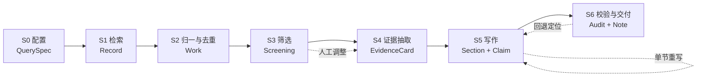

# 文献检索与综述生成 · 功能设计方案

- 日期：2026-10-28
- 状态：**P0 已落地**（0.86.0，设计评审后实现；P1/P2 见 §16）
- 基线：Papilot 0.85.0 → 0.86.0
- 关联文档：[检索订阅 v2 设计](检索订阅-设计方案-2026-10-19.md)、[开源项目调研](开源项目调研-文献检索与综述生成-2026-10-28.md)
- 配置样例：[docs/specs/lit-review.config.example.json](specs/lit-review.config.example.json)
- 落地记录：见文末 §18

---

## 0. 一页结论

**要做的事**：把「检索 → 建库 → 筛选 → 结构化 → 成稿 → 校验」做成一个**可配置、可复现、可审计**的本地流水线，
让用户用一份配置（来源 + 检索式 + 筛选规则 + 写作模板）从 PubMed 等源批量拉文献，
得到一篇六段式综述草稿，且**每条引用都能点回 Zotero 条目、并对得上原文片段**。

**怎么做（关键取舍）**：

1. **不重写检索层**。仓库已有 `SubSources`（arXiv / OpenAlex / Crossref / Europe PMC / PubMed 五源，
   含 `pubmedTerm()` 检索式编译、跨源 `dedupe()`、本地布尔复核 `matches()`、400ms 间隔与 5 分钟不可达冷却）。
   本方案在其上补三件它没有的东西：**多页游标、检索留痕、语料级筛选**。
2. **不重写写作层**。`ReviewWorkbench` 已有「大纲 → 分节 → 引用 → 导出」的可干预三步，
   本方案复用其提示词骨架与 `citeToLink()`，把「材料 = 选中条目」换成「材料 = 筛选后的语料 + 证据卡」。
3. **新增的核心是"证据层"**。现有实现只把摘要截 200 字喂给模型，模型写什么无从核对；
   本方案要求先产出**证据卡（EvidenceCard）**，卡里的每条结论必须带**原文片段（quote）**，
   写作时只能引用证据卡 id，成稿后由确定性校验器逐句核对。这是"引用与原文准确对应"的唯一可靠落点——
   靠提示词要求"不要编造"无法验收，靠**子串比对 + 数字比对**才能验收。
4. **AI 只做三件可降级的事**：结构化抽取、分节撰写、争议归纳。检索、去重、打分、编号、校验**全部确定性**，
   无 Key 时仍能完成检索、筛选、导出（只是不能成稿）。

**交付边界（一句话）**：产出的是**可核查的综述草稿与语料审计报告**，不是可直接投稿的论文，也不是 PRISMA 合规的系统评价。

---

## 1. 目标与非目标

### 1.1 目标（按用户原话拆解）

| # | 需求 | 本方案的落点 | 验收方式 |
|---|---|---|---|
| G1 | 接入 PubMed 及相关学术数据库 | 五源适配（已有）+ 多页抓取 + 源能力矩阵 | 单源失败不影响整体，`bySource` 逐源可见 |
| G2 | 按主题 / 关键词 / 自定义查询批量抓取 | `QuerySpec` 三模式，统一编译为各源语法 | 同一 QuerySpec 编译结果可快照比对 |
| G3 | 批量导入 | 批量写入 Zotero 集合（复用 `ref-import.js` 的条目创建与查重） | 导入 N 条，库内重复 0 |
| G4 | 去重 | 三级键 + 块内相似度聚类，保留版本关系 | 固定 fixture 召回 100%、误合并 0 |
| G5 | 相关性筛选 | 硬规则 → 确定性打分 → AI 复核（可选）→ 人工确认 | 每条都有分数与理由，可导出 |
| G6 | 结构化整理 | 证据卡（设计/人群/样本/结局/局限/原句） | 字段齐全率 ≥90%，quote 必须可在原文定位 |
| G7 | 六段式综述 | 固定骨架 + 可配置子标题与字数预算 | 六节齐全，字数在预算 ±25% |
| G8 | 引用与原文准确对应 | 证据 id 绑定 + 编号重排 + 四项校验 | 人工标注 40 句，绑定准确率 ≥90%，越界编号 0 |
| G9 | 可配置 | 三层配置（全局/项目/单次），JSON 可导入导出 | 配置往返（导出再导入）等价 |
| G10 | 明确边界 | 见 §1.2 与 §13 | 文档 + 界面内提示双份 |

### 1.2 非目标（明确不做，避免承诺溢出）

| 不做 | 原因 |
|---|---|
| 系统评价 / Meta 分析的统计合并（pooled effect、异质性 I²、GRADE 分级） | 需要双人独立筛选、效应量提取与统计模型，属另一专业领域；本功能只输出可交给 RevMan/R 的数据表 |
| 声称"符合 PRISMA" | PRISMA 要求检索日期、双人筛选一致性 κ、流程图与排除理由全链留痕；本功能只输出**可对照的计数与流程数据**，合规判定由人完成 |
| 绕过付费墙 / 接入 Sci-Hub | 法律与合规风险；只使用开放获取链接与用户本地已有 PDF |
| Google Scholar 抓取 | 反爬且违反其条款；需要覆盖度时用 OpenAlex / Semantic Scholar / Europe PMC 替代 |
| 自动投稿、查重、生成"可发表"文本 | 本功能定位是写作前置工作台 |
| 临床、用药或政策决策建议 | 输出为文献归纳，不构成医学建议（界面与笔记首页固定声明） |
| 把用户库内容或摘要上传到 Papilot 服务端 | 服务端只做 AI 网关，不落库；`privacy` 配置可完全关闭 AI |
| 内置任何 API 密钥 | 沿用仓库铁律；PubMed / OpenAlex 的 Key 一律走 `cred-vault` 用户自填 |

---

## 2. 与现有模块的关系

### 2.1 复用矩阵

| 现有资产 | 位置 | 本方案怎么用 | 需要补什么 |
|---|---|---|---|
| 五源适配 | `features/sub-sources.js` | 直接调用 `SubSources.search()`，沿用 `bySource` / `partial` / `_scrub` 脱敏 | 游标分页、`retstart`/`cursorMark` 续抓、检索式快照 |
| 检索式编译 | `SubSources.pubmedTerm()` / `europePmcQuery()` | 主题/关键词模式继续走它 | 新增"概念组（concept）"输入，支持 `[mh]` 主题词与 `[tiab]` 混排 |
| 跨源去重 | `SubSources.dedupe()` | 作为第一道精确键合并 | 第二轮块内相似度聚类；复用 `RefFormat.titleMatch()` 避免重复实现 |
| 本地布尔复核 | `SubSources.matches()` | 作为硬筛选的一道 | 扩为规则引擎（年份/语言/类型/撤稿/样本量） |
| 大纲与分节 | `features/review-workbench.js` | 复用 `parseOutline` / `buildSectionPrompt` / `assembleDraft` / `citeToLink` | 固定六段骨架、证据卡输入、`[[E:...]]` 标记协议、校验器 |
| 单轮整篇 | `features/review-gen.js` | 保留为"快速模式"（≤10 篇、无审计） | 不动 |
| AI 通道 | `ai/client.js` `AIClient.chat()` | 所有 AI 调用统一入口，沿用计费与降级 | 批量抽取的并发上限与预算闸 |
| 参考文献格式 | `features/ref-format.js` | 复用 `recKey` / `titleMatch` / BibTeX 解析；参考文献表按 GB/T 7714 或 Vancouver 渲染 | 增加期刊缩写与 DOI 规范化 |
| 条目导入 | `features/ref-import.js` | 语料入库走它，天然带去重与字段映射 | 传入 `provenance`（来源、检索批次）写进 `extra` |
| 全文获取 | `features/oa-fetch.js`、`fulltext-resolver.js` | 证据卡优先用本地 PDF 全文，其次 OA 链接，最后摘要 | 记录 `sourceLevel`，审计时标注"仅摘要支撑" |
| 订阅调度 | `features/search-subs.js` | **不合并**。订阅是"持续增量发现"，本功能是"一次性建库成稿" | 仅共用 `SubSources` |

### 2.2 现有实现的四个真实缺口（本方案的存在理由）

| 缺口 | 代码证据 | 后果 |
|---|---|---|
| 语料是"选中若干条"，没有检索 provenance | `ReviewWorkbench.collectMetas()` 只接受 items，`MAX_ITEMS = 30` 直接截断 | 无法回答"这篇综述覆盖了哪个检索式的多少命中"，不可复现 |
| 材料只有 200 字摘要 | `SECTION_ABSTRACT_CHARS = 200` | 样本量、效应值、局限全被截掉，"主要发现"只能写成定性套话 |
| 引用只有编号映射，没有内容核对 | `citeToLink()` 只校验编号是否越界、itemKey 是否存在 | 编号正确但内容错配（张冠李戴）无法发现 |
| 大纲是 AI 自由发挥的 4–7 节 | `buildOutlinePrompt()` 只给"例如：问题背景 → …" | 拿不到稳定的六段结构，跨篇不可比 |

---

## 3. 总体架构

六段流水线，每段都有**确定性产物**落盘，任一段失败不污染上游：



| 阶段 | 输入 | 输出 | 是否可跳过 | 失败策略 |
|---|---|---|---|---|
| S0 配置 | 用户表单 / JSON | `Project.config` 快照 | 否 | 校验失败列字段，不启动 |
| S1 检索 | QuerySpec + 源开关 | `records[]`（含 raw 与 retrieval 元数据） | 否 | 单源失败降级；全失败中止 |
| S2 去重 | records | `works[]` + `mergeLog[]` | 否 | 异常条目隔离，不整批失败 |
| S3 筛选 | works + 规则 | `screening{}` + 计数 | 可（全量纳入） | 规则异常回退"全量待审" |
| S4 抽取 | included works | `evidence[]` | 可（无 Key 时跳过） | 单篇失败留空并标注 |
| S5 写作 | evidence + 模板 | `sections[]` + `bindings[]` | 否 | 单节失败不阻塞其它节 |
| S6 校验 | 草稿 + evidence | `audit` + 笔记/文件 | 否 | 校验不过按 `strictness` 标注或阻断 |

**设计原则**：S1–S3 与 S6 是纯确定性代码（可单测、可复现）；只有 S4/S5 依赖模型，且都必须"可降级、可局部重跑"。

---

## 4. 数据模型

全部落在**项目文件**（`<dataDir>/papilot/lit-review/<projectId>.json`）与内存对象中，不进 prefs（prefs 只存"最近项目 id"与默认配置）。

```js
Project {
  id: "lr_20261028_ab12", version: 1,
  title: "GLP-1 受体激动剂与心血管结局",
  createdAt, updatedAt,
  config: Config,                 // 完整快照，保证可复现
  runs: [{
    runId, startedAt, finishedAt,
    queryHash,                    // 编译后检索式的 sha256，用于判断"是否同一检索"
    bySource: { pubmed: {ok, found, fetched, reason}, ... },
    counts: { fetched, deduped, included, excluded, maybe }
  }],
  records: [Record],
  works: [Work],
  screening: { [workId]: { decision, score, reasons: [], by: "rule|ai|human", at } },
  evidence: [EvidenceCard],
  outline: [Section],
  sections: [{ n, id, title, md, claims: [Claim], status: "ok|failed|stale" }],
  bindings: [CitationBinding],
  audit: AuditReport,
  exports: [{ format, path, at }]
}
```

```js
Record {                        // 源返回的一条，未合并
  source, sourceId,             // pmid / doi / arxiv id / openalex id
  doi, pmid, pmcid, arxivId,
  title, authors: [], year, journal, abstract,
  type, language, citationCount, isRetracted, oaUrl,
  retrievedAt, queryHash, raw?  // raw 可选，默认不存（体积）
}

Work {                          // 去重后的"一篇作品"
  id: "w_001", canonical: Record,
  aliases: [Record], versions: [{ kind: "preprint|published", doi, source }],
  fields: { title, authors, year, journal, abstract, doi, pmid },
  provenance: [{ source, sourceId, runId }],
  fingerprint: "doi:10.1056/NEJMoa1504720"
}

EvidenceCard {
  id: "ev_012", workId, sourceLevel: "abstract|fulltext|metadata",
  design, population, sampleSize, intervention, comparator,
  outcomes: [{ name, metric, value, ci, p, direction }],
  keyFindings: [String],       // ≤40 字，必须能被 quotes 支撑
  limitations: [String],
  conflictsWith: [workId],
  quotes: [{ text, loc }],     // loc: "abstract" | "fulltext:p3" | "section:results"
  confidence: 0..1,
  extractedAt, model
}

Claim { sentenceId, text, evidenceIds: [], kind: "cited|inference|unsupported" }
CitationBinding { sentenceId, workId, evidenceId, quote?, renderedNumber }
```

**为什么单独存 `Claim` 而不是只存 Markdown**：校验、局部重写、审阅高亮都需要"句 → 证据"的可寻址映射；
只存 Markdown 就只能全文重跑，正是 `ReviewGen` 当前的痛点。

---

## 5. S1 检索层

### 5.1 三种查询模式

| 模式 | 输入 | 编译方式 | 适用 |
|---|---|---|---|
| `topic` 主题 | 一句话主题 + 可选概念组 | AI 拆概念 → 用户确认 → 每组词 OR、组间 AND | 默认；医学问题首选 |
| `keywords` 关键词 | 关键词数组 + 布尔模式（all/any/phrase） | 直接映射（沿用 `SubSources` 现有逻辑） | 快速试探 |
| `custom` 自定义 | 原生检索式（PubMed 语法 / 纯文本） | 仅做语法体检，不改写；只下发给声明支持该语法的源 | 有经验的用户、馆员给的策略 |

**概念组（concept）是新引入的结构**，它解决"同一个概念有多种写法"：

```json
{"id":"c1","label":"GLP-1 RA","terms":["GLP-1 receptor agonist","semaglutide","liraglutide"],
 "mesh":["Glucagon-Like Peptide-1 Receptor Agonists"]}
```

编译到 PubMed：`("GLP-1 receptor agonist"[tiab] OR semaglutide[tiab] OR liraglutide[tiab] OR "Glucagon-Like Peptide-1 Receptor Agonists"[mh])`，
组间 `AND`，排除词统一 `NOT (...)`。编译结果**必须回显给用户**（可复制、可微调），这是"可配置"的最低诚意。

### 5.2 源能力矩阵

| 能力 | PubMed | Europe PMC | OpenAlex | Crossref | arXiv |
|---|---|---|---|---|---|
| 主题词（MeSH） | 是 `[mh]` | 是 `MESH:` | 否（概念 id） | 否 | 否 |
| 字段限定 | `[tiab] [au] [ta] [pt] [dp]` | `TITLE: AUTH: ISSN: PUB_TYPE:` | `filter=` 参数 | `query.bibliographic` | `ti: au: abs:` |
| 分页 | `retstart/retmax`，`usehistory` 可 >1 万 | `cursorMark` | `cursor` | `cursor` | `start/max_results` |
| 摘要 | `efetch` XML 有 | `resultType=core` 有 | `abstract_inverted_index` | 常有 | 有 |
| 撤稿标记 | `pt:"Retraction of Publication"` | 有 | `is_retracted` | 有限 | 无 |
| 被引量 | 无 | 有 | 有 | 有 | 无 |
| 限速（官方建议） | 无 Key 3 req/s，有 Key 10 req/s | 宽松，仍需退避 | 10 req/s，`mailto` 进礼貌池 | 宽松，`mailto` | 3 s/次 |
| 国内可达性 | 不稳定（仓库已做 5 分钟冷却） | 通常稳定 | 稳定 | 稳定 | 稳定 |

**边界**：源只对"声明支持"的语法下发自定义检索式；不支持的源自动退回主题/关键词编译，并在 `bySource` 标注 `degraded: true`。

### 5.3 抓取与限流

- 每源独立游标，`maxRecords` 截断（默认 300，硬上限 1000）；**不做无限翻页**。
- 间隔沿用 `SubSources.MIN_INTERVAL`（400ms），arXiv 走 `ArxivRateLimiter`；对 429 做指数退避（最多 3 次），
  5xx 重试 1 次，连接层失败沿用 `DEAD_TTL_MS` 冷却。
- 抓取过程**流式落盘**：每页结束即写 `records`，中途取消保留已得数据并标记 `partial: true`。
- 检索式与 `queryHash` 一起存；同一 `queryHash` 重复运行默认**跳过已见**（按 `sourceId` 去重），
  用户可勾选"重新全量抓取"。

### 5.4 检索留痕（可复现的关键）

每次运行记录：编译后检索式（逐源）、执行时间、各源命中总数与实抓数、失败原因（脱敏）、超时设置。
导出 `PRISMA 数据表` 时直接取这些计数，用户补"检索日期/执行人"即可对接流程图。

---

## 6. S2 归一与去重

### 6.1 三级键

1. **强标识**：`doi` → `pmid` → `arxivId` → `openalexId`（小写归一，去 `https://doi.org/` 前缀）。
2. **弱键**：`normTitle|year`（标题去标点空白、统一全半角、截 160 字符）。
3. **块内聚类**：同弱键的记录再比 `titleMatch ≥ 0.92`（复用 `RefFormat.titleMatch`）与首作者姓氏相似度，
   避免"同名不同文"（如 "Editorial"、"Correction"）被误合并。

### 6.2 合并规则

| 字段 | 优先级 |
|---|---|
| 标题/作者/卷期页 | 有 DOI 的正式版 > PubMed > Crossref > OpenAlex > arXiv |
| 摘要 | 最长且非空的（避免截断版覆盖全文版） |
| 被引量 | 取最大值，并记 `citationSource` |
| 撤稿状态 | 任一源标记撤稿即为 `isRetracted: true`（宁严勿松） |
| 版本关系 | 预印本与正式版**合并为一条 Work**，但保留 `versions[]`，默认展示正式版 |

### 6.3 与现有实现的差异

现有 `SubSources.dedupe()` 只做单轮精确键合并、无相似度、无版本概念；且 `fingerprint()` 与
`RefFormat.recKey()/titleMatch()` 是两套重复逻辑。本方案**收敛到 `RefFormat` 一套**，
`SubSources.dedupe()` 保留 API 但内部改调新实现（向后兼容，订阅侧行为不变）。

**验收 fixture**：20 组已知重复（同 DOI 跨源、预印本+正式版、标题大小写/副标题差异、中文标题全半角），
要求召回 100%、误合并 0；另 10 组"高相似但不同文"必须不合并。

---

## 7. S3 相关性筛选

四道闸，逐条留痕：

### 闸 1 硬规则（确定性，先砍大头）

年份区间、语言、文献类型白/黑名单、必须有摘要、排除撤稿/勘误/评论、最小被引、`species=human`（PubMed 用 `[mh]`）。
每条命中记录 `reasons: ["year<2015", "type=Editorial"]`。

### 闸 2 概念覆盖（确定性）

查询概念在标题/摘要中的覆盖率（IDF 加权），低于 `minConceptCoverage`（默认 0.5）直接排除，
理由写"仅命中 1/3 概念"。这一道专门治 OpenAlex / Crossref 的"关键词模糊召回"。

### 闸 3 打分排序（确定性，0–100）

```
score = 100 × (wT·T + wA·A + wK·K + wR·R + wQ·Q) − penalties
T 标题概念覆盖（IDF 加权）   wT=0.40
A 摘要概念覆盖                wA=0.25
K 关键词/MeSH 命中            wK=0.15
R 时效 exp(-age/τ), τ=5       wR=0.10
Q 证据类型（SR/Meta 1.0, RCT 0.9, 队列 0.75, 病例 0.5, 综述 0.45, 预印本 0.6, 社论 0.2） wQ=0.10
penalties: 撤稿 -100；语言不符 -15；无摘要 -8；仅题名命中且无摘要 -10；勘误 -20
```

阈值：`≥65 建议纳入`、`<30 建议排除`、`30–65 待定`。**阈值来自配置，不写死。**

### 闸 4 AI 复核（可选，只改建议不改决定）

对待定区（最多 60 条，批量 10 条/次）让模型输出 `{id, verdict, reason≤20字, confidence}`。
**硬约束**：AI 的结论只能调整排序与预填，最终 `decision` 必须由 `by: "human"` 落笔；
AI 失败/超预算时 `onFailure: "keep"` 保留待定，绝不静默排除。这条沿用仓库既有原则「AI 不决定入库」。

### 人工确认界面

表格列：题名 / 年份 / 来源 / 分数 / 命中概念 / 判定 / 理由 / 摘要预览。支持按分数段批量接受/拒绝、
按来源筛选、键盘 J/K 翻页。**所有拒绝必须落一个理由**（下拉 + 自由文本），这是后面写"争议与不足"和
PRISMA 排除计数的原料。

---

## 8. S4 证据抽取

### 8.1 为什么必须有这一层

六段式里的「主要发现」「争议与不足」需要**可比的结构化事实**：设计类型、样本量、干预、对照、结局与效应值。
直接从摘要生成，模型只能复述"某研究发现有关联"，写不出"三项 RCT（n=3,204）一致显示 MACE 下降 14%（HR 0.86, 95%CI 0.79–0.93）"。

### 8.2 抽取协议

- 输入：`Work.fields`（题名/作者/年/期刊/摘要）+ 可用全文的相关段落（优先本地 PDF，其次 OA）。
- 输出：严格 JSON（schema 见附录 A.2），**`quotes[].text` 必须是原文的连续子串**。
- 批量：6 篇/次（长摘要时降为 3），失败单独重试 1 次，再失败记 `confidence: 0` 并在写作时排除该卡。
- **确定性后验**（关键）：
  1. `norm(quote)` 是否为 `norm(sourceText)` 的子串（去空白、统一标点、全半角折叠）；不是则整卡降级为 `unverified`；
  2. `sampleSize` / `p` / `CI` 是否能在 quote 或 outcomes 原文中找到数字；找不到则删除该字段并记 `dropped`；
  3. `design` 必须在枚举内，否则归 `other`。
- 结果落 `evidence[]`，每卡带 `sourceLevel`。**只有 `sourceLevel=abstract` 的卡，写作时禁止使用"全文显示""该研究详细报告了"等表述。**

### 8.3 抽取失败的降级

无 AI Key 或预算耗尽：退化为**规则抽取**——正则抓 `n = 1,234`、`p < 0.05`、`HR 0.86 (95%CI 0.79–0.93)`、
`randomized` / `meta-analysis` 等设计词，生成"薄卡"（仅题录 + 数字 + 原句）。
薄卡也能支撑"主要发现"的量化句，只是缺局限与冲突判断。这样**无 Key 也能出一篇有引用、有数字的草稿**。

---

## 9. S5 写作

### 9.1 固定六段骨架（可配置子标题）

| # | 节 | 必答问题 | 默认字数 | 证据选取 |
|---|---|---|---|---|
| 1 | 引言 | 为什么值得综述？范围与纳入标准是什么？ | 600 | 背景类 + 高被引综述 |
| 2 | 研究现状 | 有哪几条研究路线？各自方法是什么？ | 1200 | 按设计/主题聚类，每簇 3–6 篇 |
| 3 | 主要发现 | 一致结论是什么？效应多大？在谁身上成立？ | 1500 | 有量化结局的卡，按结局分组 |
| 4 | 争议与不足 | 分歧点具体在哪？证据薄弱在哪？ | 900 | `conflictsWith` 非空 + 局限最多的卡 |
| 5 | 结论 | 回答研究问题；实践含义与未来方向 | 500 | 综述/Meta + 高被引 |
| 6 | 参考文献 | 按首次引用顺序编号 | 自动 | 全部被引 Work |

模板可换（`six-section` / `imrad` / 自定义），但**六段是默认值**，且 `required` 为真的节缺失时校验不通过。

**两池分离**：生成大纲时喂 `writing.outlinePool` 篇（默认 120）的**题录 + 短摘要**，只用于规划节标题与分块，
不看细节；每节撰写时只喂该节相关的 5–25 张证据卡。前者求覆盖，后者求精度——混用会同时浪费上下文并稀释引用密度。

### 9.2 引用标记协议（解决编号错位的核心）

**模型不写数字编号**，只写证据 id：

```
多项随机对照试验一致显示主要心血管不良事件风险下降 [[E:ev_012]][[E:ev_019]]，
其中 SUSTAIN-6 报告的绝对风险下降为 2.6 个百分点 [[E:ev_019]]。
```

后处理（确定性）：
1. 按**首次出现顺序**把 `ev_xxx` 映射为 `[1] [2] …`（Vancouver 式）；`citationStyle=author-year` 时映射为 `(Author et al., 2021)`。
2. 同一句多证据合并为 `[1,3]`；连续区间合并为 `[1–3]`。
3. 未在 `evidence[]` 中出现的 id → 直接判 `V1` 失败，不静默删除。
4. 渲染笔记时把编号变成 `zotero://select/library/items/<key>` 链接（复用 `citeToLink` 的思路，但以 id 为锚）。

这一层把"编号"从模型的自由度里拿走——**编号错位的根因不是模型不会数数，而是让模型数数。**

### 9.3 分节生成的三条纪律（沿用并强化 `buildSectionPrompt`）

1. 只用给定的证据卡，不得引入外部文献或常识；
2. 任何事实性陈述必须带 `[[E:id]]`；推断必须显式写"据此推断"，且 `kind` 记为 `inference`；
3. 不得写出证据卡中没有的数字、样本量、年份、直接引语。

新增第 4 条：**争议节必须成对呈现**——同一结局下结论相反的卡片要同时引用，并指出分歧点（人群/剂量/终点定义/随访时长）。

### 9.4 局部重写

用户点"重写本节"只重跑该节，输入 = 该节证据子集 + 已完成各节的一句话摘要（防重复）。
单节失败不阻塞其它节；`sections[].status` 标 `stale` 的节在证据变更后提示重跑（与"证据卡更新"联动）。

### 9.5 输出与导出

- 主产物：Zotero 笔记（Markdown 渲染，含目录、六节、参考文献、审计摘要）。
- 次产物：`.md` / `.docx`（走现有导出能力）/ `references.bib` / `corpus.csv`（含筛选判定与理由）。
- 笔记首页固定质量声明：检索源与日期、纳入/排除数、仅摘要支撑的引用占比、AI 参与环节。

---

## 10. S6 校验：引用与原文准确对应

六项检查，全部确定性，输出 `AuditReport`，按 `strictness: off|warn|block` 处置。

| 编号 | 检查 | 判据 | 处置（warn 模式） |
|---|---|---|---|
| V1 | 引用可解析 | 每个 `[[E:id]]` 存在；编号连续无空洞 | 该句标红，不允许导出为"已校验" |
| V2 | 引用覆盖率 | 被引 Work 数 / 纳入 Work 数 ≥ `coverageMin`（默认 0.6） | 列出未被引文献，提示补写或排除 |
| V3 | 数字一致 | 句中的数字（样本量、百分比、p、CI、HR/RR）必须出现在该句证据卡的 `quotes`/`outcomes` 中 | 标"数字无出处"，建议删或补证据 |
| V4 | 冲突陈述 | 句子含"一致/共识/均显示"但所引卡片存在 `conflictsWith` | 提示"存在相反证据"，给候选卡 |
| V5 | 元数据一致 | 参考文献条目的作者数/年份/期刊与 Zotero 条目字段一致 | 标差异（多为导入时的字段缺失） |
| V6 | 重复度 | 相邻段落 8-gram Jaccard > 0.35 | 提示合并或重写 |

**人工标注评测（P0 验收门）**：固定 40 句草稿（含 12 句故意错配、8 句含错数字），
要求 V1 全捕获、V3 捕获 ≥7/8、人工判定的引用-证据绑定准确率 ≥90%。

**为什么不用模型自检**：模型自检对"自己刚写的句子"有确认偏差，且成本翻倍；
子串与数字比对是零成本、可回归的。模型只用于"争议归纳"这类无法确定性判定的环节。

---

## 11. 配置体系

### 11.1 三层与优先级

```
单次运行参数  >  项目配置（Project.config）  >  全局默认（prefs: litReviewDefaults）
```

- 项目配置**随项目文件存**，导出 JSON 即"方法学附录"。
- 全局默认存 prefs（`extensions.zotero.papilot.litReview.*`），只放安全值，**不放密钥**。
- 密钥统一走 `cred-vault`：配置里写 `"cred:pubmed"` 引用名，运行时解析；导出时自动剔除为 `null`。

### 11.2 配置项说明（核心表）

**sources**

| 键 | 类型 | 默认 | 范围 | 说明 |
|---|---|---|---|---|
| `sources.enabled` | string[] | `["pubmed","europepmc","openalex"]` | 五源任意组合 | 至少 1 个；PubMed 单开即可用 |
| `sources.perSource.<id>.pageSize` | int | 100 | 10–200 | 单页条数，受源上限约束（OpenAlex 200、Crossref 1000） |
| `sources.perSource.<id>.maxRecords` | int | 300 | 1–1000 | 该源最多抓多少条，防无限翻页 |
| `sources.perSource.<id>.timeoutMs` | int | 25000 | 5000–60000 | 单请求超时；PubMed 国内常需 ≥20s |
| `sources.credentials.*` | string | `null` | `cred:<name>` 或 null | 只存引用名；PubMed Key 可将 3 req/s 提到 10 req/s |
| `sources.mailto` | string | `""` | 合法邮箱 | 进 OpenAlex/Crossref 礼貌池，显著降低 429 |

**query**

| 键 | 类型 | 默认 | 范围 | 说明 |
|---|---|---|---|---|
| `query.mode` | enum | `topic` | `topic`/`keywords`/`custom` | `custom` 只下发给支持该语法的源 |
| `query.topic` | string | `""` | ≤300 字 | 主题模式必填 |
| `query.concepts[]` | object[] | `[]` | ≤8 组 | 每组 `{label, terms[], mesh[]}`；组间 AND、组内 OR |
| `query.conceptLogic` | enum | `AND` | `AND`/`OR` | 概念太少时用 OR 扩召回 |
| `query.booleanMode` | enum | `auto` | `all`/`any`/`phrase`/`auto` | 关键词模式的布尔语义 |
| `query.customQuery.syntax` | enum | `pubmed` | `pubmed`/`plain` | 仅作语法体检依据 |
| `query.filters.dateFrom/dateTo` | string | `""` | `YYYY-MM-DD` | 空表示不限；PubMed 走 `[dp]` |
| `query.filters.languages` | string[] | `["eng","chi"]` | ISO 639-2 | 影响检索与硬筛选两处 |
| `query.filters.publicationTypes` | string[] | 见样例 | PubMed PT 词表 | 白名单；空表示不限 |
| `query.filters.excludePublicationTypes` | string[] | `["Editorial","Comment","Retraction of Publication"]` | 同上 | 黑名单优先于白名单 |
| `query.filters.hasAbstract` | bool | `true` | — | 关掉会显著增加待筛量 |
| `query.filters.openAccessOnly` | bool | `false` | — | 只留可拿到全文的（证据质量更高） |
| `query.filters.species` | enum | `human` | `human`/`animal`/`any` | PubMed 用 `[mh]` 表达 |

**dedupe / screening**

| 键 | 类型 | 默认 | 范围 | 说明 |
|---|---|---|---|---|
| `dedupe.titleThreshold` | float | 0.92 | 0.85–0.99 | 越高越保守；0.92 对副标题差异较稳 |
| `dedupe.keepVersions` | bool | `true` | — | 保留预印本/正式版关系 |
| `dedupe.preferPublished` | bool | `true` | — | 合并后展示正式版题录 |
| `screening.hardFilters` | object | `{minYear:2015, requireAbstract:true, excludeRetracted:true, minCitations:0}` | — | 闸 1 的硬规则；`minCitations` 对预印本不友好，默认 0 |
| `screening.weights.*` | float | 见 §7 | 合计=1 | 权重改动会改变排序，改后需重算分数 |
| `screening.thresholds.include/exclude` | int | 65 / 30 | 0–100 | 区间内为"待定" |
| `screening.minConceptCoverage` | float | 0.5 | 0–1 | 低于则闸 2 直接排除 |
| `screening.aiReview.enabled` | bool | `true` | — | 关掉则纯确定性筛选 |
| `screening.aiReview.maxCandidates` | int | 60 | 0–200 | 控制成本；超出的待定项保留人工处理 |
| `screening.aiReview.onFailure` | enum | `keep` | `keep`/`skip` | **不允许 `exclude`**，避免误杀 |

**extraction / writing**

| 键 | 类型 | 默认 | 范围 | 说明 |
|---|---|---|---|---|
| `extraction.enabled` | bool | `true` | — | 关掉则用规则薄卡 |
| `extraction.sourceLevel` | enum | `abstract-first` | `abstract-only`/`abstract-first`/`fulltext-first` | 影响耗时与费用 |
| `extraction.maxWorks` | int | 60 | 1–200 | 只对前 N 篇（按分数）抽取 |
| `extraction.maxQuotesPerWork` | int | 3 | 1–8 | 每条都要过子串校验 |
| `extraction.batchSize` | int | 6 | 1–10 | 长摘要自动降到 3 |
| `extraction.fields` | string[] | 见样例 | 8 个字段子集 | 关掉某字段即不抽（如不需要 `comparator`） |
| `writing.language` | enum | `zh` | `zh`/`en`/`bilingual` | 双语时英文节单独生成 |
| `writing.citationStyle` | enum | `numeric` | `numeric`/`author-year` | 影响编号与参考文献渲染 |
| `writing.outline.template` | enum | `six-section` | `six-section`/`imrad`/`custom` | 自定义时 `sections[]` 生效 |
| `writing.outline.sections[]` | object[] | 六节 | 2–10 节 | `{id,title,budget,required,generated}` |
| `writing.outlinePool` | int | 120 | 20–300 | **大纲参考池**（看广度）：生成大纲时喂入的高分文献数，与每节证据上限分离（借鉴 AutoSurvey） |
| `writing.maxEvidencePerSection` | int | 25 | 5–60 | 超长上下文会掉引用质量 |
| `writing.markInference` | bool | `true` | — | 推断句加"（推断）"前缀，审计更诚实 |

**verification / delivery / budget / privacy**

| 键 | 类型 | 默认 | 范围 | 说明 |
|---|---|---|---|---|
| `verification.strictness` | enum | `warn` | `off`/`warn`/`block` | `block` 时不通过不出笔记 |
| `verification.checks.V1..V6` | bool | 全 `true` | — | 可单独关（如 V6 重复度） |
| `verification.coverageMin` | float | 0.6 | 0–1 | 低于则提示"有文献未被引用" |
| `delivery.formats` | string[] | `["note","markdown","csv"]` | `note`/`markdown`/`docx`/`csv`/`bibtex` | `docx` 走现有导出能力 |
| `delivery.collection` | string | `auto` | `auto`/集合名 | `auto` 建 `<主题> · 综述语料` 子集合 |
| `delivery.prismaReport` | bool | `true` | — | 导出计数表（非合规声明） |
| `budget.maxAiCalls` | int | 30 | 1–200 | 硬闸，超限即停并保存进度 |
| `budget.maxInputTokens` | int | 400000 | — | 与现有计费口径一致 |
| `budget.onExceed` | enum | `stop` | `stop`/`degrade` | `degrade` 用规则薄卡继续 |
| `privacy.sendAbstractsToAI` | bool | `true` | — | 关掉只能出规则薄卡与骨架 |
| `privacy.storeRawResponses` | bool | `false` | — | 默认不存原始响应，减少磁盘与泄漏面 |

### 11.3 配置校验规则（启动前）

- `enabled` 为空、`topic` 与 `concepts` 同时为空、`custom` 模式表达式为空 → 拒绝启动并定位到字段。
- `weights` 合计偏离 1.0 超过 0.01 → 自动归一 + 提示。
- `thresholds.include <= thresholds.exclude` → 拒绝。
- `sections` 缺 `required` 节 → 警告（不阻断，导出时审计标注）。
- `maxRecords × enabled.length > 2000` → 提示预计耗时。
- 所有 `cred:` 引用解析失败 → 该源标记"缺凭据"，不阻断其它源。

---

## 12. 界面与交互

**入口**（三处，沿用现有习惯）：
1. 工具菜单 →「文献综述 → 检索并生成综述」；
2. 文献发现窗口 →「用当前检索建综述项目」；
3. 功能中心卡片（`hub.js`）→「综述工作台 2.0」。

**向导四步**（一个窗口，左侧步骤条，右侧内容，底部固定"上一步/下一步"）：

| 步 | 内容 | 关键交互 |
|---|---|---|
| 1 检索 | 源勾选、模式切换、概念组编辑、语料规模预估 | "试跑 10 条"按钮：只抓不存，验证检索式 |
| 2 语料 | 去重结果、筛选表、分数分布直方图 | 批量接受/拒绝、按来源过滤、J/K 键 |
| 3 大纲 | 六节骨架 + 可编辑子标题 + 每节证据数 | 显示"本节可用证据 12 张（量化 5 张）" |
| 4 成稿 | 分节进度、每节重写、审计面板 | 审计项点击跳转到对应句子；导出按钮组 |

**必须做好的失败态**：

| 场景 | 表现 |
|---|---|
| PubMed 超时 | 该源行标"不可达（5 分钟内不再重试）"，其它源结果照常展示 |
| 全部源失败 | 明确列出每源原因 + 建议（换 Europe PMC / 检查代理） |
| 无 AI Key | 向导可走完 S0–S3 与导出；步 3/4 显示"仅骨架与规则薄卡"，并给配置入口 |
| 预算耗尽 | 停在当前节，已生成内容保留，提示"提高预算或改用规则模式" |
| 校验 block 未过 | 给出前 5 条问题与定位，提供"降级为 warn 导出"选项（需二次确认） |

**不做**：不做 Markdown 富文本编辑器（用 Zotero 笔记原生编辑）；不做多项目并排对比（P2 再谈）。

---

## 13. 存储、隐私与合规

| 项 | 方案 |
|---|---|
| 项目文件 | `<dataDir>/papilot/lit-review/*.json`，单项目上限建议 8 MB（`raw` 默认不存） |
| 语料条目 | 写入用户指定集合（默认自动建子集合）；`extra` 写 `Papilot-LitReview: <projectId>` 便于溯源 |
| 笔记 | 常规 Zotero 笔记，含质量声明与审计摘要；不写隐藏字段 |
| 密钥 | `cred-vault`（AES-GCM 托管），配置只存 `cred:` 引用名；导出自动脱敏 |
| 云同步 | 项目文件**不进**云同步（体积大、含检索策略）；只同步最终笔记与配置模板（不含凭据） |
| 服务端 | 只经 AI 网关转发模型请求；不上传语料、不落库、不做画像 |
| 合规提示 | 首次使用弹一次：本功能为写作辅助，引用需人工复核；摘要级综述需在文中标注 |

---

## 14. 性能与配额预算

以"3 源 / 300 条/源 / 纳入 60 篇"的典型规模估算：

| 阶段 | 请求/调用 | 预估耗时 | 说明 |
|---|---|---|---|
| S1 检索 | 3 源 × 3 页 = 9 请求 | 15–40 s | PubMed 慢时可达 60 s（有 25 s 超时与冷却） |
| S2 去重 | 0 | <300 ms | 900 条阻塞 + 块内比对 |
| S3 筛选 | 0（AI 复核 6 次） | <1 s + 20 s | 确定性部分纯本地 |
| S4 抽取 | 60/6 = 10 次 | 1–3 min | 与模型速度相关 |
| S5 写作 | 1（大纲可跳过）+ 5 节 = 6 次 | 2–5 min | 单节 400–1500 字 |
| S6 校验 | 0 | <200 ms | 纯字符串/数字比对 |
| **合计** | **约 22 次 AI 调用** | **5–10 min** | 预算闸默认 30 次，留余量 |

**优化点**：抽取结果按 `workId + 摘要 hash` 缓存（跨项目复用）；同 `queryHash` 复用 `records`；
证据卡与 `evidenceId` 稳定，重写单节不重抽。

---

## 15. 测试与验收

### 15.1 测试分层（沿用仓库现有手法）

| 层 | 文件 | 覆盖 |
|---|---|---|
| 纯函数 | `test/lit-query.test.js` | 检索式编译（PubMed/Europe PMC 各 15 例黄金串）、概念组布尔、语法体检 |
| 纯函数 | `test/lit-corpus.test.js` | 去重 fixture（20 组重复 + 10 组难负例）、打分单调性、硬筛选理由 |
| 纯函数 | `test/lit-cite.test.js` | `[[E:]]` 解析、编号重排、区间合并、越界、V1–V6 各 3 例 |
| 编排（桩 HTTP） | `test/lit-review-flow.test.js` | 单源失败、429 退避、部分成功、预算耗尽、断点续跑 |
| 迷你 DOM | `test/lit-review-ui.test.js` | 四步向导状态机、失败态文案、按钮禁用条件 |
| 联网探针 | `scripts/diag/probe-lit-sources.js` | 五源真实可达性与字段完整性（不进 CI） |
| 真机 | 手动清单 | 条目导入、笔记渲染、`zotero://` 链接跳转、导出 docx |

### 15.2 验收标准（P0 门禁）

1. 同一 QuerySpec 两次编译结果字节一致（`queryHash` 相同）。
2. 去重 fixture 召回 100%、误合并 0。
3. 1000 条记录硬筛选 + 打分 < 2 s。
4. 引用审计：40 句标注集，V1 全捕获、V3 ≥7/8、绑定准确率 ≥90%。
5. 无 AI Key 时全流程可走到"导出语料 + 规则薄卡骨架"，不出现死路。
6. 单源超时不影响其它源，界面有明确归因。
7. `preflight.py --strict` 全绿（新增套件计入步数，跳过即失败）。
8. 打包后真机装载、跑通一次 30 篇的小规模成稿（含笔记与导出）。

### 15.3 需要同步改的守卫

- `scripts/check-wiring.py`：新增 prefs 键、模块装配顺序、面板控件 ↔ 处理函数一一对应。
- `scripts/preflight.py`：新增测试套件加入清单（缺文件按失败，勿落白名单）。
- `manifest.json` 版本号、`prefs.js` 默认值、设置面板折叠卡计数（改面板必须 bump + 出包，见分册 34）。

---

## 16. 分期实施

### P0（建议 0.86.0）· 打通主链

**新增**：`features/lit-query.js`、`features/lit-corpus.js`、`features/lit-audit.js`、`features/lit-review.js`、
`chrome/content/lit-review.xhtml` + `lit-review-ui.js`、`prefs-lit-review.js`、`test/lit-*.test.js`

**复用改造**：
- `sub-sources.js`：`search()` 增加 `paging` 与 `queryHash`，`dedupe()` 内部改调新实现；
- `review-workbench.js`：抽出 `buildOutlinePrompt` 支持固定骨架、`buildSectionPrompt` 支持证据卡与 `[[E:]]`；
- `ref-import.js`：支持 `provenance` 附加字段。

**范围**：五源检索（含分页）、去重、硬筛选 + 打分、六段大纲、分节生成、引用绑定、V1/V2/V3 校验、笔记导出。
**不含**：AI 复核筛选、证据卡全字段、CSV/PRISMA、模板 UI。

### P1（0.87.0）· 证据层与审计

证据卡抽取（含 quote 子串校验）、规则薄卡降级、V4/V5/V6、审计面板与定位跳转、
CSV/BibTeX/PRISMA 计数表、配置导入导出与模板编辑、抽取缓存。

### P2 · 提升召回与质量

- **主动学习筛选**（借鉴 ASReview）：本地 TF-IDF + 线性 SVM（纯 JS 手写，零依赖），
  用户标注 20 条后重排剩余，逐轮收敛；保留"人始终是 oracle"。
- **全文分块检索**（借鉴 paper-qa 的 RCS 思路，但本地 BM25）：证据卡从"摘要级"升到"段落级"。
- **写-评-改循环**（借鉴 SurveyX 的 writer-critic）：争议节单独走一轮 critic，输出"分歧点清单"再重写。
- 多项目对比、课题组共享模板（不含语料）。

---

## 17. 风险与对策

| 风险 | 影响 | 对策 |
|---|---|---|
| PubMed 国内不稳定 | 主源不可用 | 默认同时开 Europe PMC（含 PubMed 记录）；已有 5 分钟冷却；界面明确归因 |
| 摘要级证据导致结论偏弱 | "主要发现"缺量化 | 强制标注 `sourceLevel`；优先用本地 PDF；审计里给"仅摘要支撑占比" |
| 模型仍写无出处断言 | 引用不可信 | 标记协议 + V3 数字比对 + 覆盖率；`strictness: block` 可硬拦 |
| 上下文超限 | 后段引用质量下降 | 每节证据上限 25 张 + 按簇选卡；超出提示分批 |
| 费用失控 | 用户成本 | 预算闸（调用数/token）、抽取只做前 60 篇、缓存复用 |
| 语料污染用户库 | 库变乱 | 独立子集合 + `extra` 标记 + 一键"删除本项目条目" |
| 与订阅功能混淆 | 维护成本 | 共用 `SubSources`，但调度、状态、UI 完全分离；文档写清分工 |
| 检索式不可复现 | 方法学质疑 | `queryHash` + 逐源检索式快照 + 运行历史只增不改 |

---

## 附录 A · 提示词与输出契约

### A.1 检索式编译（`topic` 模式，AI 只拆概念）

```
system: 你是医学信息检索助手。把用户主题拆成 2-6 个"概念组"，每组给出同义词、缩写、商品名与 MeSH 主题词。
输出 JSON：{"concepts":[{"label":"","terms":[""],"mesh":[""]}]}
禁止输出检索式本身；不确定的 MeSH 词留空数组。
```

编译由确定性代码完成，AI 输出只作为**可编辑草稿**。

### A.2 证据卡抽取（严格 JSON）

```
system: 你是文献信息抽取器。只依据给定文本抽取，不得推断。
输出 JSON：
{"cards":[{"workId":"","design":"RCT|cohort|case-control|case-series|in-vitro|animal|modeling|survey|qualitative|review|meta-analysis|other",
"population":"","sampleSize":null,"intervention":"","comparator":"",
"outcomes":[{"name":"","metric":"HR|RR|OR|MD|%","value":null,"ci":"","p":"","direction":"decrease|increase|none"}],
"keyFindings":[""],"limitations":[""],"quotes":[{"text":"","loc":"abstract"}]}]}
规则：quotes[].text 必须是原文连续子串（不改写、不省略号）；每个 keyFinding 至少 1 条 quote 支撑；
文本没有的字段填 null 或空数组，禁止猜测。
```

### A.3 分节撰写

```
system: 你是严谨的综述写作者。证据纪律：
1) 只用给定证据卡，不引入外部文献或常识；
2) 事实性陈述必须带证据标记 [[E:id]]，可并列多个；推断必须写"据此推断"，不得伪装成文献结论；
3) 不得写出证据卡未给出的数字、样本量、年份、直接引语；
4) 争议必须成对呈现，并指出分歧点（人群/剂量/终点/随访）；
5) 只写本节，不重复其它节；不输出参考文献表；纯 Markdown。
user: 【本节】第 3 节《主要发现》，目标：…… 字数 1200–1500
【已完成节】1 引言（要点：……）；2 研究现状（要点：……）
【证据卡】共 18 张（含 12 张量化）……
```

### A.4 审计报告结构

```json
{"coverage": 0.72, "citedWorks": 43, "includedWorks": 60,
 "unknownCitations": [], "unsupportedNumbers": [{"section":3,"sentence":"...","token":"HR 0.78"}],
 "conflictClaims": [{"section":4,"sentence":"...","conflictingWorks":["w_012"]}],
 "metadataMismatches": [{"workId":"w_007","field":"year","paper":"2021","zotero":"2020"}],
 "abstractOnlyRatio": 0.35}
```

---

## 附录 B · 检索式编译示例

输入（`topic` 模式，概念组）：

| 组 | terms | mesh |
|---|---|---|
| c1 | GLP-1 receptor agonist / semaglutide / liraglutide / dulaglutide | Glucagon-Like Peptide-1 Receptor Agonists |
| c2 | cardiovascular outcome / MACE / major adverse cardiovascular events | Cardiovascular Diseases |
| c3 | type 2 diabetes / T2DM | Diabetes Mellitus, Type 2 |

排除：`editorial`, `comment`

编译结果（PubMed）：

```
(("GLP-1 receptor agonist"[tiab] OR semaglutide[tiab] OR liraglutide[tiab] OR dulaglutide[tiab]
  OR "Glucagon-Like Peptide-1 Receptor Agonists"[mh])
 AND ("cardiovascular outcome"[tiab] OR MACE[tiab] OR "major adverse cardiovascular events"[tiab]
  OR "Cardiovascular Diseases"[mh])
 AND ("type 2 diabetes"[tiab] OR T2DM[tiab] OR "Diabetes Mellitus, Type 2"[mh]))
AND ("2015/01/01"[dp] : "3000"[dp])
NOT (editorial[pt] OR comment[pt])
```

Europe PMC：

```
(TITLE_ABS:"GLP-1 receptor agonist" OR TITLE_ABS:semaglutide OR MESH:"Glucagon-Like Peptide-1 Receptor Agonists")
AND (TITLE_ABS:"cardiovascular outcome" OR TITLE_ABS:MACE)
AND PUB_YEAR:[2015 TO 2026]
NOT PUB_TYPE:"editorial"
```

**注意**：`[dp]` 的右侧日期用 `3000` 是 PubMed 的常用写法（表示不限上限）；编译时若 `dateTo` 为空则用此写法，
有值则填 `YYYY/MM/DD`。这一步必须有黄金串单测，防止拼接出非法检索式。

---

## 18. 落地记录（0.86.0）

### 18.1 实际交付

| 文件 | 行数级别 | 职责 |
|---|---|---|
| `chrome/content/scripts/features/lit-query.js` | ~470 | 配置归一/校验/指纹、五源检索式编译（黄金串有单测） |
| `chrome/content/scripts/features/lit-corpus.js` | ~560 | 多源抓取（逐源分页）、Record 归一、并查集去重、0–100 打分、筛选、CSV、入库 |
| `chrome/content/scripts/features/lit-audit.js` | ~330 | `[[W:id]]` → 编号、参考文献、V1–V3 审计、笔记链接化 |
| `chrome/content/scripts/features/lit-review.js` | ~520 | 六段骨架、按节选材、提示词、AI 编排、项目存取、窗口门面 |
| `chrome/content/lit-review.xhtml` + `lit-review-ui.js` | ~250 + ~520 | 四步窗口（检索/语料/成稿/审计），纯按钮式控件规避皮肤问题 |
| `sub-sources.js`（改） | +~130 | `searchOne()` 单源单页、`offset/cap` 分页、`_q`/`_arxivSpec` 预编译注入、`_pubmedRich`（efetch XML 带摘要）、`parsePubmedXml` |
| `main.js` / `menus.js` / `hub.js` / `utils.js` / `prefs.js` | 小改 | 装配 4 个模块、工具菜单与功能中心入口、`litReviewEnabled` 开关 |
| `test/lit-{query,corpus,audit,review}.test.js` | 38+56+46+58 断言 | 纯函数 + 编排 + 窗口静态接线 |

### 18.2 与设计稿的偏差（均为收紧，不是缩水）

1. **Europe PMC 不分页**：接口一次最多 300 条（`pageSize` 上限），因此该源单请求取满；PubMed / OpenAlex / Crossref 走 `retstart` / `page` / `offset` 真翻页，arXiv 由 `ArxivFetch.search` 内部翻页。
2. **PubMed 语料改走 `efetch` XML**：`esummary` 不返回摘要，而摘要正是筛选与写作的原料；解析用定点正则（bootstrap 作用域无可用 DOMParser），单篇失败只跳过该篇。
3. **P0 未做证据卡**：写作材料为「题录 + 摘要（700 字符）」，引用绑定到**作品**级（`[[W:id]]`）；设计稿里的 `[[E:id]]` 已在解析器预留（`LitAudit.render` 接受 `evidence` 映射），P1 接证据卡即可切换。
4. **未做 AI 复核筛选**：P0 只有硬规则 + 概念覆盖 + 打分 + 人工切换；这与"AI 不决定入库"一致。
5. **V4–V6 未启用**：只落 V1（可解析）、V2（覆盖率）、V3（数字出处）。
6. **关键词按空格分词**（实机回归后补）：原实现把 `semaglutide cardiovascular` 当整串短语，
   PubMed 直接 0 命中；现在空格分词、短词并入前项，短语需用户自己加引号。

### 18.3 真机验证（两轮端到端）

- 打包：`papilot-0.86.0.xpi`，包内 manifest 0.86.0、229 条目、sha256 已核对。
- 安装后 boot 日志：`startup begin v0.86.0` → `init complete`，无模块加载失败。
- **窗口自检（临时探针，验证后已撤）**：启动 3 秒后自动开窗，日志 `lit-review selftest: win=1 toggles=5 rows=1 err=` —— 窗口成功创建、5 个数据源切换按钮与语料表容器都取到，UI 初始化无异常。
- 门禁：`preflight --fast` 141 项 / 通过 140 / 失败 0 / 跳过 1（浏览器 E2E 需 `NODE_PATH`，非本功能）。
- 正式包已重新构建并覆盖安装（探针不在包内，boot 日志无 selftest 行）。
**端到端实机自检（临时探针驱动窗口控件，验证后已撤）**

| 轮次 | 操作 | 结果 |
|---|---|---|
| 第 1 轮 | 关键词 `semaglutide cardiovascular`，每源 20 | PubMed **0** / Europe PMC 9 → 去重 9 篇。零命中不是网络故障（`bySource.pubmed.ok=true`），而是**整串被当短语**：`"semaglutide cardiovascular"[tiab]` |
| 修复 | 关键词按空格分词、≤2 字符短词并入前项（`type 2 diabetes` → `"type 2"` + `diabetes`）；中文片段整体保留 | 新增 3 组回归用例（46 项断言） |
| 第 2 轮 | 同条件重跑 | PubMed **20** + Europe PMC **20** → 去重 **28 篇（合并 12）**；判定 16 纳入 / 0 待定 / 12 排除；表格 28 行；点判定 `include→maybe`；CSV 30 行；项目自动保存 1 个、清理后 0 |
| 写作链路 | 桩替身 `AIClient.chat/hasKey`（真实模型未登录，只验代码路径） | 5/5 节、5 次调用、草稿 1994 字、含参考文献；审计 v1 报错（桩故意引用未提供的作品，V1 正确拦截）、覆盖率 6.3%、V3 报 10 处数字无出处；笔记创建成功（id 26353）后已删除 |

结论：检索、去重、打分筛选、表格交互、判定切换、CSV、项目存取、分节生成、编号绑定、审计、笔记落盘全部在真实 Zotero 里跑通；
真实模型生成需登录账号，本次未验（AI 未登录时界面给出明确指引，且不产出空壳稿）。

### 18.4 使用路径

工具菜单 →「检索并生成综述」/ 功能中心 →「检索并生成综述」→
① 选源与模式（主题/关键词/自定义）→ 试跑 20 条看检索式 → ② 检索建语料、逐条改判定 → 导入 Zotero / 导出 CSV →
③ 生成六段草稿（可编辑）→ ④ 看审计（覆盖率、越界引用、数字无出处）→ 保存笔记 / 导出 Markdown。
项目自动存于 `<数据目录>/papilot/lit-review/*.json`，窗口左上「打开项目」可回看。
